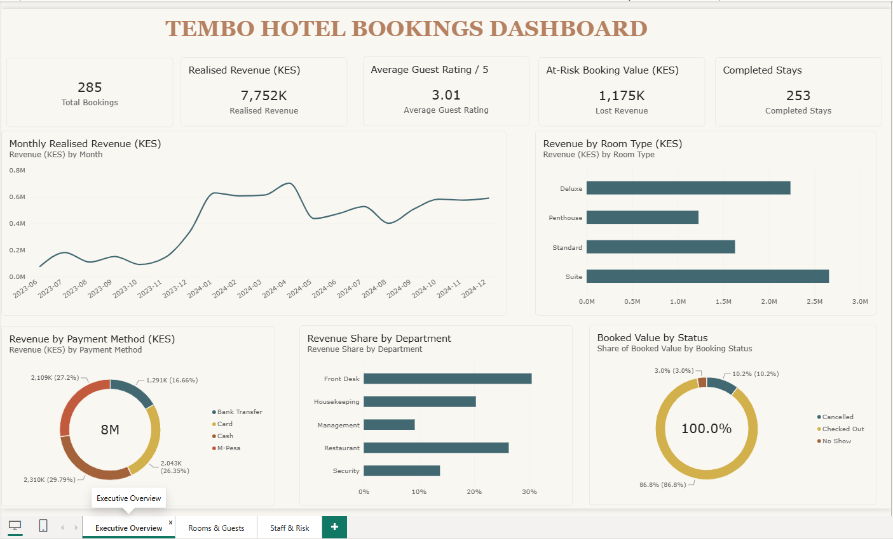

# Power BI dashboard

A three-page Power BI dashboard that answers the Hotel Director's four questions: which rooms earn the most, which months are busiest, how the staff perform, and whether guests are happy. It reads the cleaned data from one PostgreSQL view, and the two money rules live in that view.

## Contents

- [What is in this folder](#what-is-in-this-folder)
- [The three pages](#the-three-pages)
- [Open the dashboard](#open-the-dashboard)
- [How the model is built](#how-the-model-is-built)
- [Page maps: visual to measure](#page-maps-visual-to-measure)
- [Known issues](#known-issues)
- [Before you share the project](#before-you-share-the-project)

## What is in this folder

| Path | What it holds |
| --- | --- |
| `screenshots/` | The three dashboard pages as images |
| `project/Tembo_hotel.pbip` | The Power BI project file. Open this one. |
| `project/Tembo_hotel.Report/` | Page and visual definitions |
| `project/Tembo_hotel.SemanticModel/` | The data model: one table and 25 measures |
| [`measures.md`](measures.md) | Reference for every DAX measure |

## The three pages

| Page | Job | Screenshot |
| --- | --- | --- |
| Executive Overview | Money and trend at a glance | [View](screenshots/01-executive-overview.png) |
| Rooms & Guests | Who stays, for how long, and how they feel | [View](screenshots/02-rooms-and-guests.png) |
| Staff & Risk | People and lost money | [View](screenshots/03-staff-and-risk.png) |

## Open the dashboard

### Before you begin

- Power BI Desktop on Windows.
- The PostgreSQL view `tembo_hotel.v_clean_bookings`. Run `sql/01_setup_and_cleaning.sql` first, as the [main README](../README.md#quick-start-sql) explains.

### Steps

1. Open `project/Tembo_hotel.pbip` in Power BI Desktop.
2. Choose **Home**, then **Transform data**. Select the table `tembo_hotel v_clean_bookings` and open its **Source** step.
3. Replace the server and database with yours. The project ships with `localhost:5432` and `defaultdb`.
4. Choose **Close & Apply**, then **Refresh**. Enter your database credentials when Power BI asks.
5. Check the first page. The cards should read 285, 7,752K, 3.01, 1,175K and 253.

> **If the file will not open:** some versions of Power BI Desktop list project files as a preview feature. Turn on **Power BI Project (.pbip) save option** under **File, Options and settings, Options, Preview features**, then restart.

> **If the numbers differ:** run the reconciliation query in the [Power BI article](https://dev.to/david_mwandairo/building-the-tembo-hotel-dashboard-in-power-bi-cj6) and compare. The view, not Power BI, is the usual cause.

## How the model is built

The model is a single flat table. Power BI imports one object, the view `v_clean_bookings` in the `tembo_hotel` schema, and builds 25 measures on top.

### The view adds four reporting columns

| Column | What it holds |
| --- | --- |
| `stay_month` | The first day of the check-in month |
| `month_label` | The same month as text, such as `2023-06`. Text in `YYYY-MM` form sorts in time order. |
| `realised_revenue` | The booking amount for `Checked Out` bookings, and zero for the rest |
| `lost_revenue` | The booking amount for `Cancelled` and `No Show` bookings, and zero for the rest |

### Where each rule lives

| Rule | Where | How |
| --- | --- | --- |
| Realised revenue counts `Checked Out` bookings only | SQL | `realised_revenue` column, summed in DAX |
| Lost value counts `Cancelled` and `No Show` bookings | SQL | `lost_revenue` column, summed in DAX |
| A completed stay is a `Checked Out` booking | DAX | `CALCULATE` filter on `booking_status` |
| Average rating uses completed stays only | DAX | The same filter, plus `AVERAGE`, which skips blank ratings |
| A month is the month of check-in | SQL | `stay_month` and `month_label` |

### Display folders

| Folder | Measures |
| --- | ---: |
| 01 Booking Volume | 2 |
| 02 Revenue | 4 |
| 03 Room Demand | 2 |
| 04 Guest Satisfaction | 5 |
| 05 Staff Performance | 3 |
| 06 Booking Losses | 6 |
| 07 Monthly Trend | 3 |

## Page maps: visual to measure

### Executive Overview

| Visual | Title on the page | Fields | Measures |
| --- | --- | --- | --- |
| Card | (caption only) | none | `[Total Bookings]` |
| Card | Realised Revenue (KES) | none | `[Realised Revenue]` |
| Card | Average Guest Rating / 5 | none | `[Average Guest Rating]` |
| Card | At-Risk Booking Value (KES) | none | `[Lost Revenue]` |
| Card | Completed Stays | none | `[Completed Stays]` |
| Line chart | Monthly Realised Revenue (KES) | Axis `month_label` | `[Realised Revenue]` |
| Bar chart | Revenue by Room Type (KES) | Axis `room_type` | `[Realised Revenue]` |
| Donut chart | Revenue by Payment Method (KES) | Axis `payment_method` | `[Realised Revenue]` |
| Bar chart | Revenue Share by Department | Axis `staff_department` | `[Department Revenue Share]` |
| Donut chart | Booked Value by Status | Axis `booking_status` | `[Booking Status Value Share]` |

### Rooms & Guests

| Visual | Title on the page | Fields | Measures |
| --- | --- | --- | --- |
| Column chart | Completed Stays by Room Type | Axis `room_type` | `[Completed Stays]` |
| Bar chart | Average Stay Length by Room Type | Axis `room_type` | `[Average Stay Nights]` |
| Bar chart | Completed Stays by Guest City | Axis `guest_city` | `[Completed Stays]` |
| Column chart | Guest Rating Distribution | Axis `guest_rating` | `[Rating Distribution Share]` |
| Bar chart | Average Rating by Room Type | Axis `room_type` | `[Average Guest Rating]` |

### Staff & Risk

| Visual | Title on the page | Fields | Measures |
| --- | --- | --- | --- |
| Table | Staff Performance | `staff_name`, `staff_department` | `[Staff Booking Rank]`, `[Bookings Handled]`, `[Completed Stays]`, `[Lost Bookings]`, `[Realised Revenue]` |
| Bar chart | Realised Revenue by Department (KES) | Axis `staff_department` | `[Realised Revenue]` |
| Bar chart | Cancellation and No-Show Rate by Room Type | Axis `room_type` | `[Lost Booking Rate]` |
| Table | Lost Bookings by Payment Method | `payment_method` | `[Lost Bookings]`, `[Lost Booking Rate]`, `[Lost Revenue]`, `[Staff Handling Count]` |

## Known issues

The dashboard works and its totals tie to SQL. A review found items to repair. The [Power BI article](https://dev.to/david_mwandairo/building-the-tembo-hotel-dashboard-in-power-bi-cj6) explains each one and shows the fix.

| Priority | Issue | Where |
| --- | --- | --- |
| Fix first | The Rank column ranks each person inside their own department, so six of eight staff show rank 1 | Staff & Risk, Staff Performance table |
| Fix first | One idea has two names: "At-Risk Booking Value" and "Lost Revenue". Two loss rates (11.2% of bookings, 13.2% of value) carry no label. | Executive Overview cards, Staff & Risk |
| Fix first | Donut centres read "8M" and "100.0%", which add nothing and contradict the 7,752K card | Executive Overview |
| Fix first | The status donut labels repeat each figure, as in "10.2% (10.2%)" | Executive Overview |
| Fix next | Bars sort alphabetically, with no data labels. The page has no slicers. | All pages |
| Fix next | Seven finished measures sit on no visual, among them month-over-month growth and the Top 10 city rank | Model |

